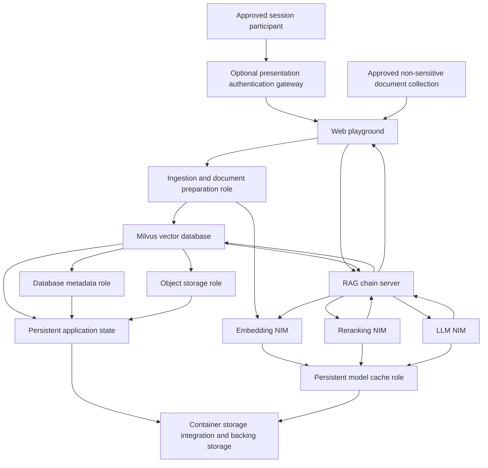
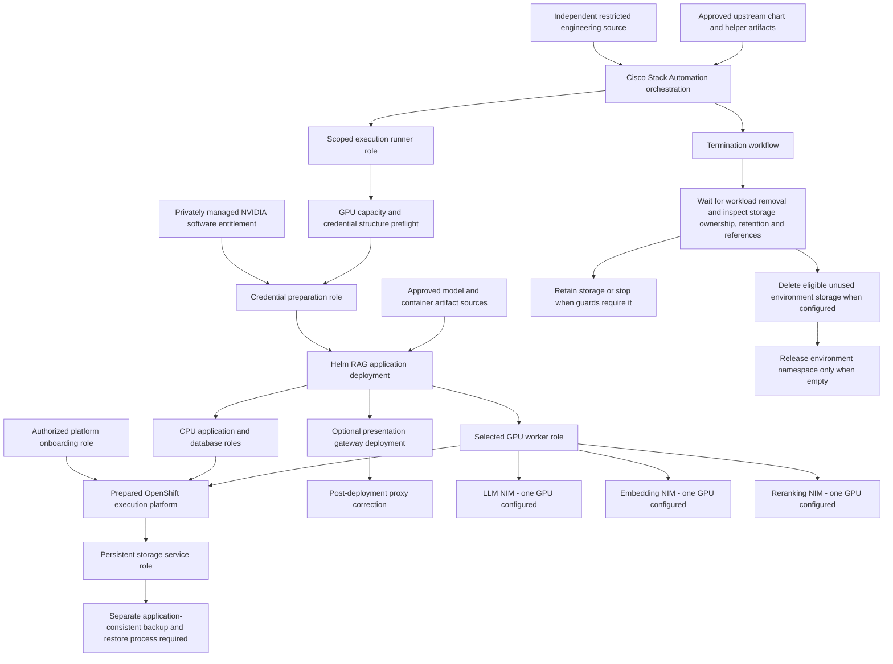

# Functional architecture and sanitized logical topologies

> **UNDER VALIDATION — PARIS BSC LABORATORY**

These are **source-derived functional views**, not a live inventory or an implementation map. Logical labels conceal actual infrastructure identities. No addresses, internal DNS names, service names, ports, access routes, network zones, device counts or management endpoints are published. Arrows express functional dependencies, not permitted network connections. Physical network design and controls cannot be reconstructed from these views.

## Application and data flow

The chain server, playground, three NIM roles and Milvus are explicitly described in the reviewed engineering definition. Ingestion is a **functional role**, not an assertion that a separate ingestion service is deployed. The storage lifecycle documentation refers to coordinated Milvus, etcd and MinIO data; the diagram uses metadata and object-store roles rather than actual deployment identities. Per-component volume attachment and exact cache placement must be checked against the rendered chart and deployed inventory before runtime sign-off. The chart dependency itself was not available as a reviewed source artifact in this publication.

Ingestion prepares document content, creates embeddings and makes content available for retrieval. A question then flows through embedding, retrieval, reranking and contextual generation. These arrows describe the intended mechanism from the source description and general RAG model; the current runtime execution trace has not been published. Source attribution, answer accuracy and permission enforcement must be evaluated independently.

The configured authenticated presentation path is shown. Source also permits presentation without that gateway; it is a configuration option, not a validated secure deployment pattern. Gateway authentication does not prove document-level authorization or transport encryption.

## Automation and control dependencies

The sequence reflects source dependencies, including the post-gateway correction and cleanup role attached to termination. Destruction ordering, failure recovery and repeatability still require laboratory execution evidence. Manual security onboarding is a prerequisite, not an automated application step. Entitlement and artifact arrows describe dependencies only; credential handling details and acquisition paths remain private.

## Dependency and responsibility boundaries

| Functional area | Role in the pilot | Evidence boundary |
|---|---|---|
| Cisco Stack Automation | Source-defined application orchestration, resource selection and lifecycle hooks | Definition inspected; full lifecycle execution not independently verified |
| OpenShift platform | Workload scheduling, service identity and persistent volume integration | Integration targeted in source; platform version only historically reported |
| GPU software and hardware | LLM, embedding and reranking execution | Target and allocation configured; actual profiles/digests/driver inventory pending |
| CPU application layer | Web interaction, chain orchestration and database roles | Roles described; rendered resource inventory pending |
| Storage | Model cache and application data persistence | Lifecycle behavior described and guarded in code; recovery/reclamation evidence pending |
| Artifact and entitlement services | Software, models and access entitlement | Required dependencies; availability, egress policy and offline operation unverified |
| Security and operations | Platform onboarding, identity, transport, logging and recovery ownership | Responsibilities required; controls are not certified by this catalog |

No additional Cisco security, observability or fabric product is shown as deployed or tested. The broader [Secure AI Factory reference](references.md#ext-06--cisco-secure-ai-factory) is solution context, not proof that every reference-architecture component exists in this pilot.
